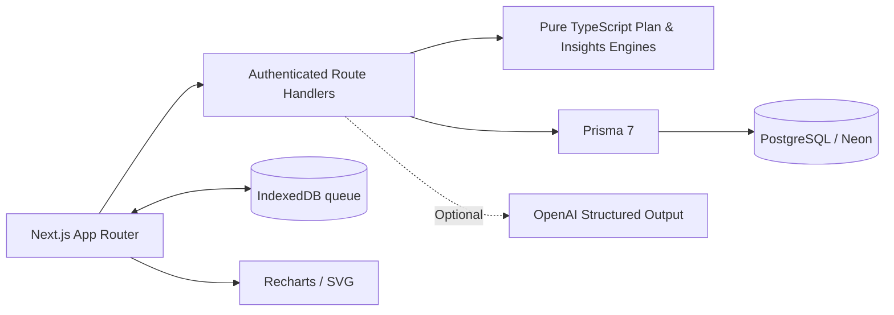

# GymTrack — Full-Stack Workout Tracker

**Next.js 16 · TypeScript · Prisma 7 · PostgreSQL · Auth.js · Recharts · Vitest**

A standalone source project assembled from the GymTrack specification: login and registration, read-only seeded demo, exercise library, rule-based and manual plan builders, workout logging, rest timer, history, progress charts, heatmaps, optional AI natural-language logging, IndexedDB queue, and consent-based coach/client management.

> **Build status:** The project was assembled from scratch for this delivery. It was not built against a live npm registry or database in the packaging environment. Run the local verification commands before treating it as production-ready.

## Quick start — Windows PowerShell

**Install first:** Node.js 22.12+ (or Node 24), npm, [Docker Desktop](https://www.docker.com/products/docker-desktop/).

```powershell
# Extract ZIP and open PowerShell inside the gymtrack-full directory
Copy-Item .env.example .env
# Replace AUTH_SECRET in .env with a secure random value (32+ characters)
node -e "console.log(require('crypto').randomBytes(32).toString('base64url'))"
# Start Docker Desktop, then:
docker compose up -d
npm install
npm run db:push
npm run db:generate
npm run db:seed
npm run dev
```

Open **http://localhost:3000**. Try the shared demo account without registration or register your own account for editing and logging.

If PostgreSQL is already using port 5432, change Docker port mapping to `5433:5432` and replace `localhost:5432` with `localhost:5433` in both database URLs in `.env`.

## Key pages

- `/register`, `/login` — credentials authentication (optional Google OAuth)
- `/dashboard` — personal workspace
- `/onboarding` — rules-based plan suggestion
- `/plans/new`, `/plans` — manual plan builder, activation and launch
- `/exercises`, `/exercises/[slug]` — seeded exercise library
- `/workouts/[id]`, `/workouts/history` — logging and workout history
- `/dashboard/progress` — PRs, weekly volume, estimated strength, weigh-ins
- `/dashboard/heatmaps` — training calendar and SVG muscle heatmap
- `/dashboard/coaches`, `/coach` — consent-based coach management

## Architecture



## Environment

Copy `.env.example` and configure at least `DATABASE_URL`, `DIRECT_URL`, and `AUTH_SECRET`. Credentials login and normal set logging **do not require** Google or OpenAI credentials. Google login only appears if both Google environment variables are set. AI parsing returns a configuration message without an API key.

The provided `docker-compose.yml` creates a **local development-only** database. `npm run db:push` is for local development. For production, create reviewed Prisma migrations with `npx prisma migrate dev --name initial` against development and deploy committed migrations via `npx prisma migrate deploy`.

## Tests

```powershell
npm run test:run
npm run lint
npm run typecheck
npm run build
npx playwright install chromium
npm run test:e2e
```

The existing GitHub Actions workflow uses a disposable PostgreSQL service and runs the same checks.

## Caveats

- This is an integrated starter, **not a security-audited production deployment**.
- The shared demo is read-only; accounts need a real database to work.
- AI extraction requires `OPENAI_API_KEY` and user confirmation; manual entry works without it.
- Local set queue retries when the app is open. It does not promise full offline restoration of private pages after a reload or support automatic resolution of conflicting set numbers.
- Background Sync is best-effort and unavailable in Safari; a foreground reconnect retry is provided.
- Coach promotion is admin-only and body-weight access requires separate client consent.
- Fitness calculations are informational, not medical advice. 1RM estimates are not prescriptions to attempt maximal loads.

**Recommended before public release:** test real end-to-end journeys, review database mutations and coach permissions, add distributed rate limits, and measure Lighthouse scores against a deployed production build.

## Coach/admin role setup (local only)

Register an ordinary account first. In PowerShell, set an environment variable pointing to that account and promote it on your own development database:

```powershell
$env:ADMIN_EMAIL = "you@example.com"
npm run admin:promote
```

Sign out and sign back in, then open `/admin/coaches` and promote a different registered account to coach. Coach invites are accepted by the client under `/dashboard/coaches`. The user must separately consent to sharing body-weight history.

## Tailwind CSS v4 setup

This project uses Tailwind CSS v4 (`@import "tailwindcss"` in `src/app/globals.css`). The source includes `tailwindcss`, `@tailwindcss/postcss`, and `postcss` in `devDependencies`, together with `postcss.config.mjs`. Run `npm install` after extracting the corrected ZIP, then restart `npm run dev`. If you replace an existing project folder, remove its old `.next` directory before restarting.
